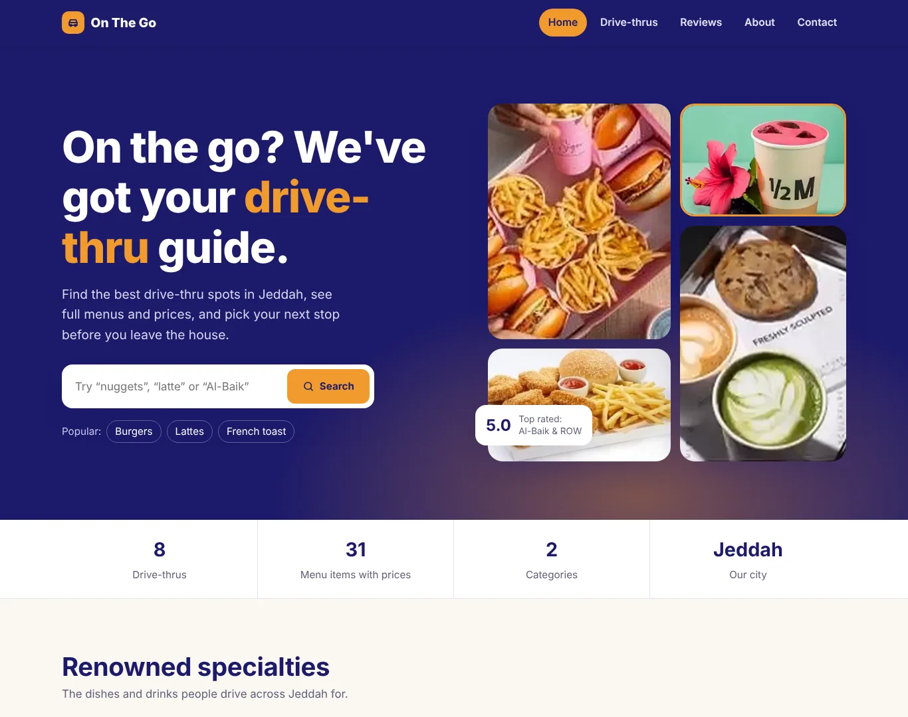
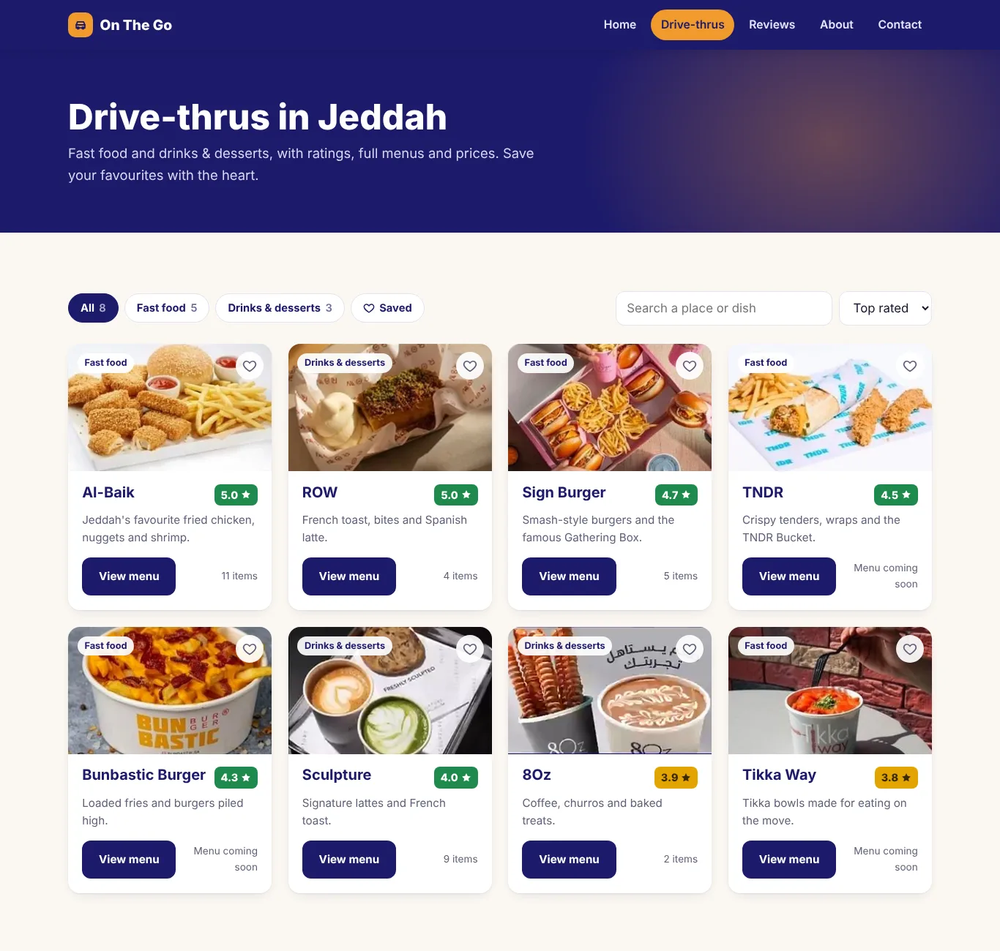
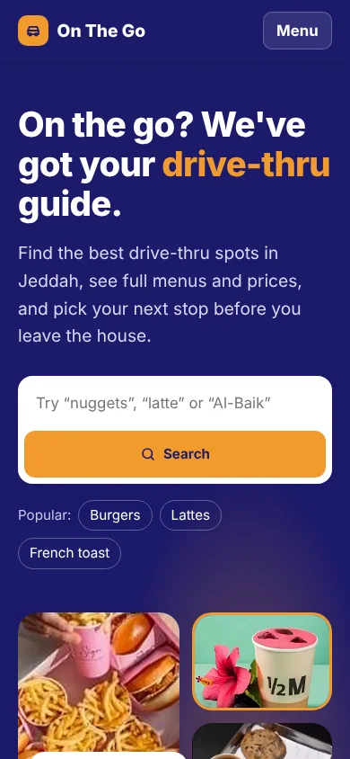
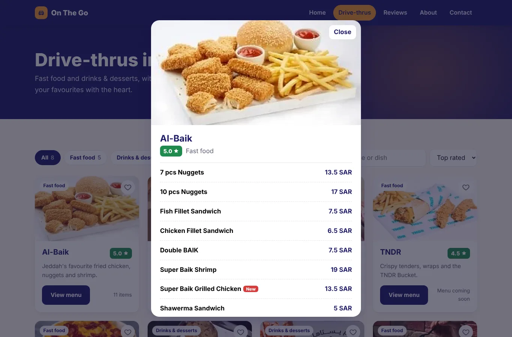

# On The Go · Jeddah drive-thru guide

**CS2111 Web Development project · Effat University · Oct–Dec 2024**
Built by **Dana Al Mounayer** and **Judy Al-Imam**

**Live site:** https://danamounayer.github.io/CS2111-Web-Development-Project/



On The Go helps people in Jeddah find drive-thru spots, compare ratings, see full menus with prices in SAR, and read reviews before they head out.

## Features

| Page | What you can do |
|---|---|
| **Home** | Search by place or dish, browse renowned specialties, jump into a category, see the top-rated drive-thrus |
| **Drive-thrus** | Filter by category, search, sort by rating or name, save favourites, open any menu in a popup |
| **Reviews** | Read reviews with star ratings, see the average, post your own (saved in your browser) |
| **About** | What the guide offers, why drive-thrus, and the team |
| **Contact** | Validated contact form that opens your email app with the message ready |

<p>
  
  
</p>



## Drive-thrus in the guide

**Fast food:** Al-Baik (5.0), Sign Burger (4.7), TNDR (4.5), Bunbastic Burger (4.3), Tikka Way (3.8)
**Drinks & desserts:** ROW (5.0), Sculpture (4.0), 8Oz (3.9)

## How it's built

- Plain **HTML, CSS and JavaScript**, with no frameworks and no build step
- All content (restaurants, menus, specialties, reviews) lives in [`js/data.js`](js/data.js), so updating the guide means editing one file
- Favourites and new reviews are stored with `localStorage`
- Responsive down to small phones, keyboard accessible, and respects reduced-motion settings

```
├── index.html          Home
├── drive-thrus.html    All drive-thrus, filters and menus
├── reviews.html        Reviews and review form
├── about.html          About and team
├── contact.html        Contact form
├── css/style.css
├── js/data.js          Site content
├── js/app.js           Interactions
└── images/
```

## Run it locally

Download the repo and open `index.html` in any browser.

## Team

- **Dana Al Mounayer**: [GitHub](https://github.com/DanaMounayer)
- **Judy Al-Imam**
